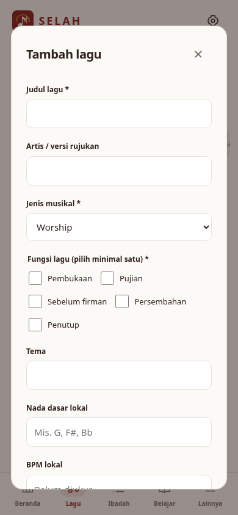
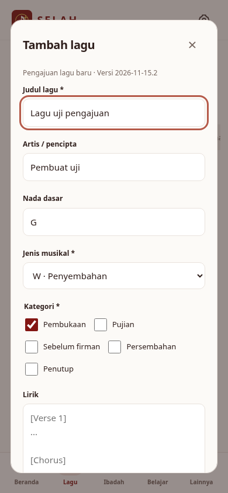
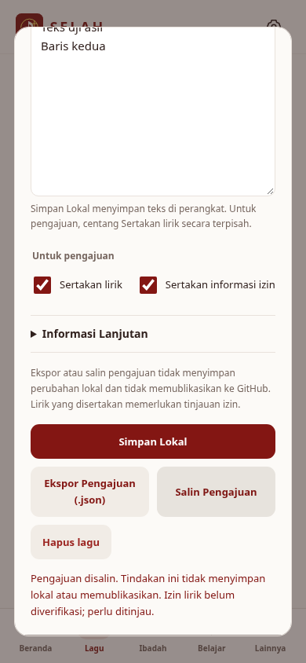
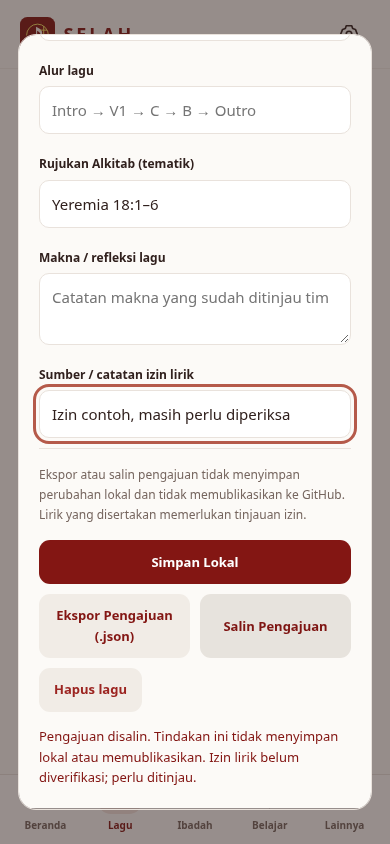

# v0.5.1 — Song Content Submission review

Baseline: `8f0b243` on `main` (includes the published Bejana-Mu update). App/UI/cache: `0.5.1`. Public content version stays `2026-11-15.2`; `data/songs.json`, `data/legacy-v02.json`, manifest and all public song IDs are unchanged.

The existing song editor now prioritizes title, creator, key, type, categories and lyrics. Supplemental fields are in Informasi Lanjutan. Simpan Lokal keeps its existing behavior. Ekspor Pengajuan (.json) and Salin Pengajuan create independent one-song proposals without saving the draft, changing catalog files or publishing anything.

EDIT compares against the public record captured when the form opened, including any existing local override in the proposed values. Original/proposed values, changed fields and explicit field statuses distinguish unchanged/modified/cleared. Lyrics and permission text each require an unchecked-by-default opt-in. Omission is never deletion. Client permission assertions always remain unverified. Local-only records export as ADD with no public ID. See [submission format and review instructions](../../CONTENT_GUIDE.md).

## Before / after

Chromium screenshots at 390×844 CSS pixels. Dummy test text only; no personal backups or journals are included.

| Before (v0.5.0) | After: primary fields |
| --- | --- |
|  |  |

| Independent actions and review feedback | Advanced information |
| --- | --- |
|  |  |

Further captures: [360×640](add-360x640.png), [412×915](add-412x915.png), [1440×900](add-1440x900.png). EDIT: [360×640](edit-360x640.png), [390×844](edit-390x844.png), [412×915](edit-412x915.png), [desktop](edit-1440x900.png). The editor scrolls within its dialog; actions remain reachable on small screens. The persistent shell/navigation is unchanged.

## Verification performed

All commands below passed on 2026-11-15. Browser tests used system Chromium with externally available Playwright, served at `http://127.0.0.1:8765/selah/` to exercise a GitHub Pages project subpath. No package/build/runtime dependency was added.

```sh
node tests/validate.mjs
node tests/catalog-merge.mjs
node tests/service-model.mjs
node tests/song-submission.mjs
node --check assets/app.js
node --check assets/song-submission.js
node --check sw.js
node tests/song-submission-browser.cjs
node tests/experience-browser.cjs
SELAH_SCREENSHOT_DIR=/tmp/selah-v051-service node tests/service-builder-browser.cjs
node tests/fluidity-browser.cjs
SELAH_SCREENSHOT_DIR=/tmp/selah-v051-welcome node tests/welcome-browser.cjs
```

- Submission model: whitelist, ADD/EDIT shape, stable public IDs, original values, category/line-ending equality, unchanged/modified/cleared/omitted fields, no-change rejection, explicit lyrics/rights inclusion, unverified permissions, filenames, title/categories/type/status/BPM/URL validation, URL credential rejection and coherent/unknown content-version observations.
- Submission browser journeys at **360×640, 390×844, 412×915 and 1440×900**: file download and clipboard JSON, descriptive filenames, captured public version, existing local override vs public original, intentional clearing, opt-in reset, original lyric clearing, invalid/hidden advanced field feedback, ADD/local-only ADD, explicit local Save with unchanged IDs, and offline cold reload/export. Exports/copies leave the exact stored JSON unchanged. Sentinels for other songs/journals/setlists/credentials remain absent; no non-GET network requests occurred.
- Extra browser cases: public refresh while an editor is open preserves its original/version; reopening captures the new baseline; missing version metadata permits offline export with a review warning; denied clipboard reports an Indonesian error without writing storage.
- Accessibility checks: associated core labels, native modal keyboard containment, reachable controls, Indonesian error/status live regions, responsive overflow checks; 200% root text scaling in the 390px editor remains scrollable without horizontal overflow. Existing suites cover focus return, reduced motion, larger text, stable navigation and route transitions. This is targeted browser coverage, not a full screen-reader audit.
- Existing journeys across the same four sizes: all routes/tabs, search and filters, song add/edit/delete and lyrics, history, setlists/templates/segments, unrestricted selections and overrides, copying/sharing/export/print layout, backup/import, legacy migration, learning progress, reflections, checklists, local persistence and offline reload. Service tests also pass trusted mobile touch dragging, cancellation, concurrent refresh safety and migration from both historical storage keys.
- Actual cached app upgrade in a disposable copy of baseline `8f0b243`: opened v0.5.0, saved local key/lyrics/rights and seeded private plan/journal/progress test values; installed the v0.5.1 worker, observed the waiting-update notice, closed all app tabs and reopened. Compared the full schema-2 state exactly (only additive `publishedContentVersion` differs), preserved `musicMinistry.v1`, verified old-cache removal and performed offline cold reload plus submission using the newly cached module. Export omitted unselected sensitive fields and left storage unchanged. Fixture removed afterward.
- `git diff --check` and unchanged public-catalog/frozen-baseline/manifest checks passed. CI now includes the new pure submission validation suite and module syntax check.

## Review / remaining device checks

No automatic publication, catalog import endpoint, backend, CMS or GitHub writer was introduced. Reviewers must compare submitted originals and observed version against the current catalog, resolve stale submissions, preserve omitted fields and verify lyrics permissions before a separate content PR. An observed offline version can be older than the server and is not cryptographic provenance.

Physical Android/iOS installation, Safari download/clipboard behavior, device safe-area/keyboard behavior and assistive-technology review remain manual. No live Pages deployment was attempted before review. This release changes no public song content.
