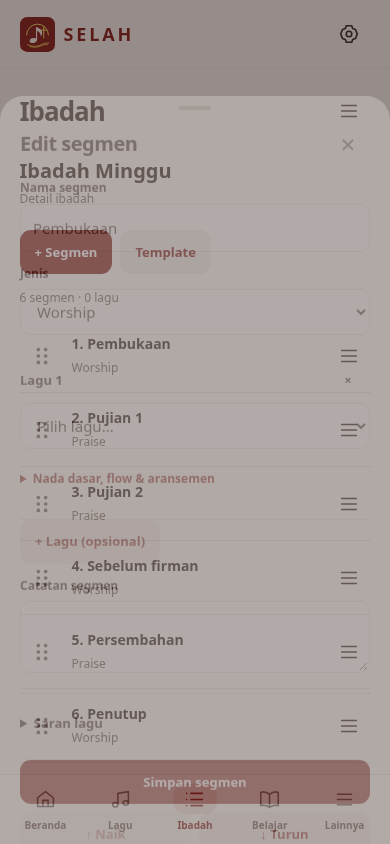
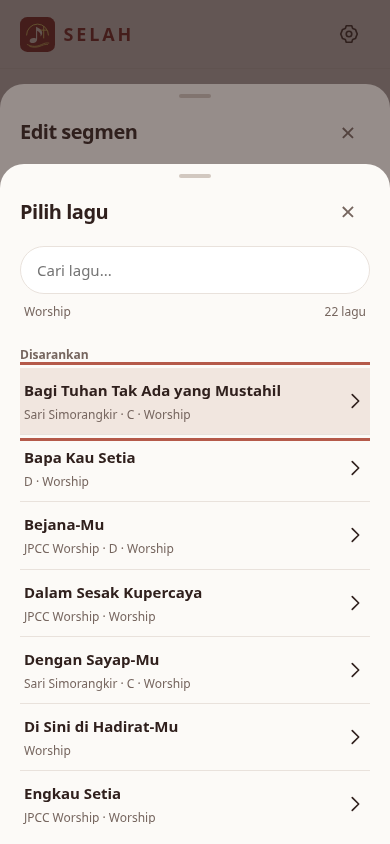
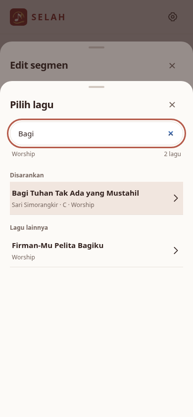
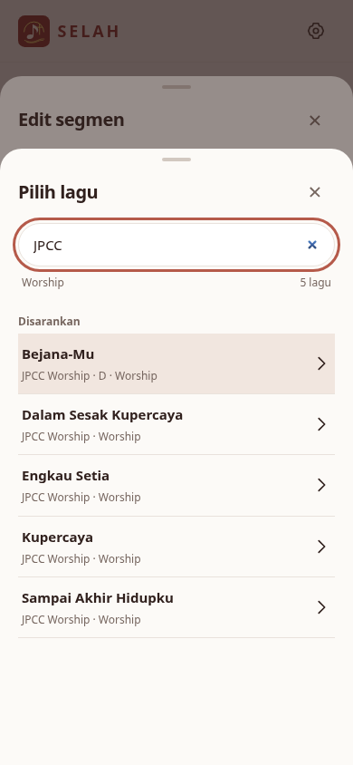

# v0.5.2 — Service song picker

Baseline: `44a29e5` (`main`, including the reviewed 2026-11-16 song batch). App/UI/cache: `0.5.2`. Public content stays `2026-11-16.1`; no published songs or frozen legacy catalog were changed.

The Service Builder now filters new choices by Jenis: Worship → W, Praise → P, Bebas → both. Medley, Instrumental and other segment types retain both musical types. Service category only groups matching choices into **Disarankan** and **Lagu lainnya**; it never excludes matching songs. The responsive picker searches titles, artists and keys, with compact rows and no per-title “saran” suffix.

Changing Jenis updates choices immediately. If selected, known songs would become incompatible, confirmation explains that their references will be cleared in the editor, with service keys/flows/notes retained. Cancel restores the previous type and all selections; nothing is written until Simpan segmen. Closing the editor discards its draft. A legacy mismatch displays a notice and requires confirmation before replacement, but is never automatically removed on load/save/import. Missing references remain intact.

## Screenshots

| Before: native dropdown | After: searchable picker |
| --- | --- |
|  |  |

| Recommendation groups | Search |
| --- | --- |
|  |  |

[Updated editor](editor-390.png) · [Bebas](bebas-390.png) · [360×640](picker-360x640.png) · [412×915](picker-412x915.png) · [desktop 1440×900](picker-1440x900.png).

The picker uses the existing sheet styling on mobile and a centered dialog on desktop. Search and Close stay visible while results scroll. Native modal containment, labelled controls, result count announcements, selected states and keyboard Arrow/Home/End navigation are included; Escape returns focus to the invoking row. Existing reduced-motion rules apply.

## Validation performed

All commands passed on 2026-11-16. Browser testing used externally available Playwright and system Chromium under the GitHub Pages-style `/selah/` project path. No framework, dependency, backend or CMS was added.

```sh
node tests/validate.mjs
node tests/catalog-merge.mjs
node tests/service-model.mjs
node tests/song-submission.mjs
node tests/service-song-picker.mjs
node --check assets/app.js
node --check assets/service-builder.js
node --check assets/service-song-picker.js
node --check sw.js
node tests/service-song-picker-browser.cjs
SELAH_SCREENSHOT_DIR=/tmp/selah-v052-service node tests/service-builder-browser.cjs
SELAH_SCREENSHOT_DIR=/tmp/selah-v052-experience node tests/experience-browser.cjs
node tests/fluidity-browser.cjs
SELAH_SCREENSHOT_DIR=/tmp/selah-v052-welcome node tests/welcome-browser.cjs
node tests/song-submission-browser.cjs
```

- Pure rules: W/P/Bebas, category groups without exclusions, normalized case/accent/multiword searches, empty results, immutable inputs, incompatible known selections only, preserved missing references, and validation/template/export round-trips using Bebas.
- Picker browser tests at **360×640, 390×844, 412×915 and 1440×900**: exact eligible IDs, recommended vs other grouping, out-of-category choices, search/empty results, refresh on type/category changes, confirm/cancel incompatible type changes, clearing only the incompatible entries of a mixed segment, preserved entry IDs/keys/flows/notes, editor cancellation without storage writes, explicit save, keyboard focus/containment/selection/Escape, enlarged root text/overflow and offline reload/edit/persistence. Mobile cases use touch-capable viewport emulation; physical-device interaction remains manual.
- Legacy data from **both storage keys**: known mismatches and missing references survive schema-1 migration and editing. Old mismatches receive a warning; dismissing replacement keeps the picker and saved data unchanged. Replacing only changes the draft until saved. Missing IDs remain stored when the segment is saved.
- An open picker reflects a refreshed catalog while preserving its search query and editor. Jenis changes also immediately refresh open results; stale choices cannot bypass the current type filter.
- Existing Service Builder suite: segment editing/reorder/duplicate/delete, medleys/non-musical segments, overrides, templates, multiple saved plans, sharing/export/print, standalone/full backup import and offline persistence across all four sizes. It now uses Bebas when intentionally choosing across musical types and the searchable picker instead of native selects. Trusted touch dragging, cancellation and refresh safety still pass.
- Existing application, song submission, welcome and fluidity suites pass at all four sizes: navigation, search/filters, editor, lyric reader, progress/reflections, backup, offline, motion/focus/history and layout. The submission browser harness now accepts a screenshot output directory; historical evidence remains unchanged.
- Actual cached upgrade in a disposable copy of baseline `44a29e5`: opened cached 0.5.1, saved dummy local song overrides, seeded plan/journal/progress test values and retained the legacy key. Installed 0.5.2, observed waiting-update guidance, closed/reopened, compared the entire stored state exactly and verified old cache removal. Offline cold reload then loaded the new picker module, saved a Praise choice in Bebas and persisted it across reload; songs and independent submission export remained intact. Fixture removed afterward.
- Syntax/static/catalog checks and `git diff --check` pass. CI includes the new rule tests and module syntax check.

## Compatibility and remaining checks

Storage keys and schema 2 are unchanged. `free` is a new segment type, so plans/templates containing Bebas require **v0.5.2+** to open; schema-1 and existing schema-2 inputs remain supported. No reconciliation/migration rule removes incompatible or missing songs. Public catalog IDs/content and local song profiles are untouched.

Physical Android/iOS installation, Safari, hardware keyboard/screen-reader review and real device keyboard/safe-area behavior remain manual. No live GitHub Pages deployment or merge was performed before review.
