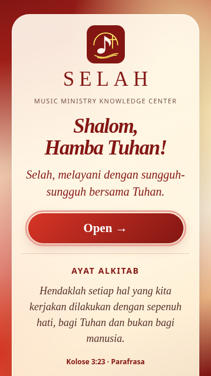
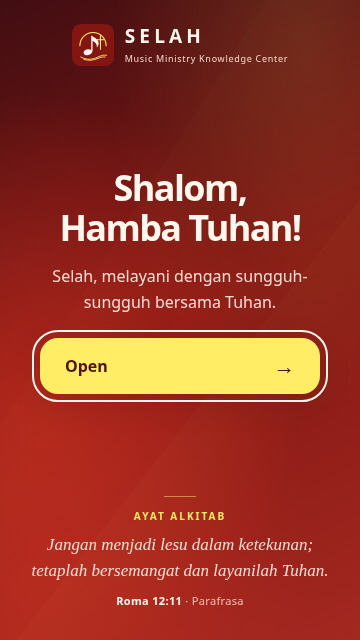
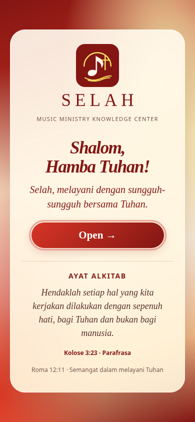
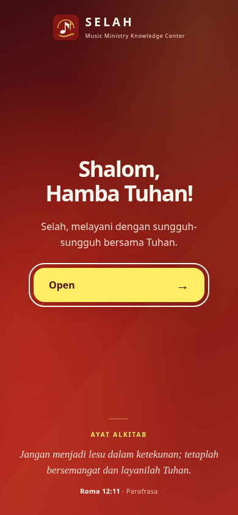
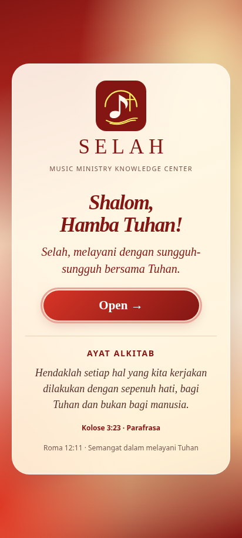
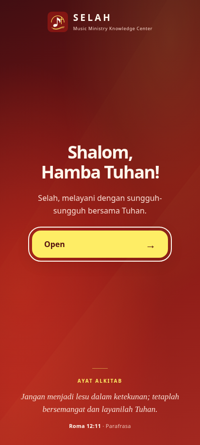

# Immersive welcome — review evidence

App-shell version: **0.3.2** (increments the existing 0.3.1 release). Public catalog/content version and `assets/app.js` are unchanged.

The welcome uses CSS gradients and a slow opacity animation, local system fonts, a smaller logo and a Baby Yellow action. Roma 12:11 is explicitly presented as a paraphrase. All visuals are cached with the existing app shell, without external dependencies.

## Screenshots

Chromium, CSS pixels, reduced motion; the visible outline shows initial keyboard focus on Open.

| Viewport | Before | After |
| --- | --- | --- |
| 360 × 640 |  |  |
| 390 × 844 |  |  |
| 412 × 915 |  |  |

[Desktop: 1440 × 900](after-1440x900.png)

## Checks completed

- All four required Node validation/syntax commands pass.
- Headless Chromium: all primary content fits without welcome scrolling at the three requested phone sizes and 1440 × 900; no horizontal overflow.
- Open, footer reopening, initial focus, keyboard activation and app-shell inert state pass. No page errors in these flows.
- Reduced motion disables the light animation; normal motion enables it. Enlarged default text (root font size 32px) remains horizontally contained and all welcome content can be reached by scrolling.
- Supplemental 320 × 400 check confirms vertical scrolling reaches the scripture and Open button.
- At all four main sizes, offline reload retains the new welcome, 38-song library and dummy academy progress; saved storage is unchanged by welcome dismissal/reopening and reload.
- Separate temporary fixture upgraded the actual 0.3.1 shell to 0.3.2: waiting/update notice, close/reopen activation, new yellow button and Roma 12:11, old cache cleanup and offline reload pass. A dummy local song-key edit and academy progress survive byte-for-byte in local storage.
- Only welcome markup/styles, viewport metadata and displayed app version changed in HTML/CSS. Song data, legacy baseline, app logic and other module markup remain unchanged.

## Reproduce browser checks

The application remains dependency-free. The optional browser test uses an **externally installed** Playwright and Chromium; it is not included in the Node-only CI workflow. This environment already supplies both.

From a persistent terminal, serve the workspace:

```sh
python3 -m http.server 8765 --bind 127.0.0.1 --directory /workspace
```

From `/workspace/selah`:

```sh
node tests/validate.mjs
node tests/catalog-merge.mjs
node --check assets/app.js
node --check sw.js
node tests/welcome-browser.cjs
```

Set `SELAH_TEST_URL` and `CHROMIUM_PATH` if using a different server or browser. The browser test regenerates the after screenshots using disposable browser contexts and dummy local progress. It never changes the published catalog or a user's browser profile.

## Device checks still needed

Actual Android/iOS standalone installation, browser toolbar transitions, device safe-area rendering and OS text scaling require physical-device verification. Safe-area CSS and `viewport-fit=cover` are included; this Chromium build does not provide the CDP safe-area emulation method, so simulated insets were not verified. The 200% root-font test is a text-layout approximation, not a claim of testing every accessibility setting. There is no new installation or service-worker lifecycle mechanism in this change.

After owner approval and deployment, open the installed PWA on a notched phone, confirm text/buttons clear the top and bottom safe areas, rotate the phone, enlarge system text, and verify scrolling can reach all content. Wait for the update notice, close all SELAH windows, reopen, then test offline. This branch is for review; it has not been merged or deployed.
